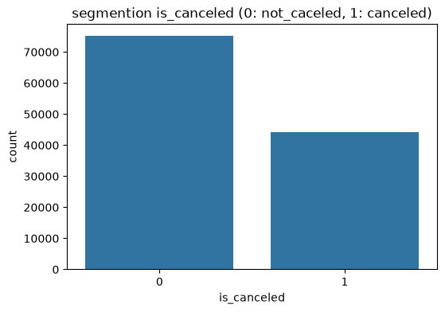
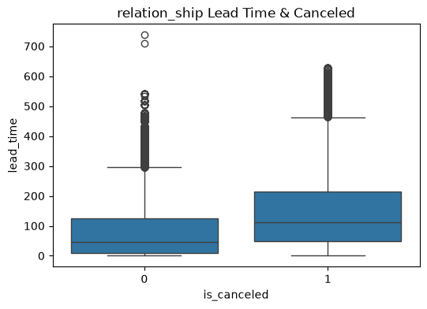
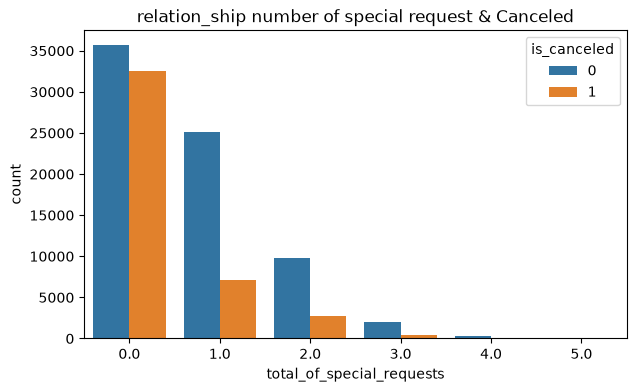
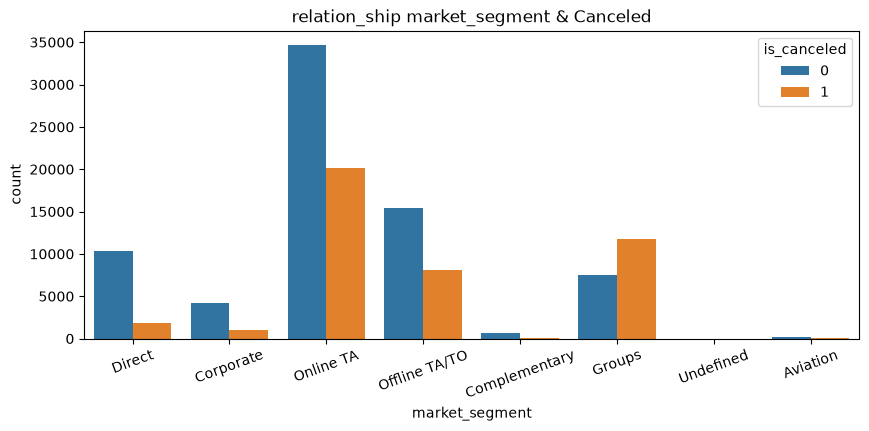
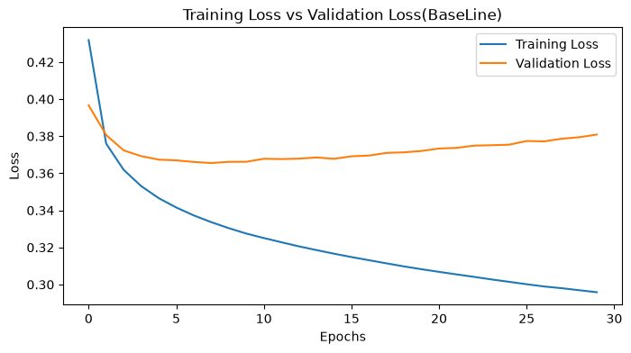
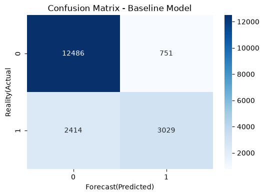
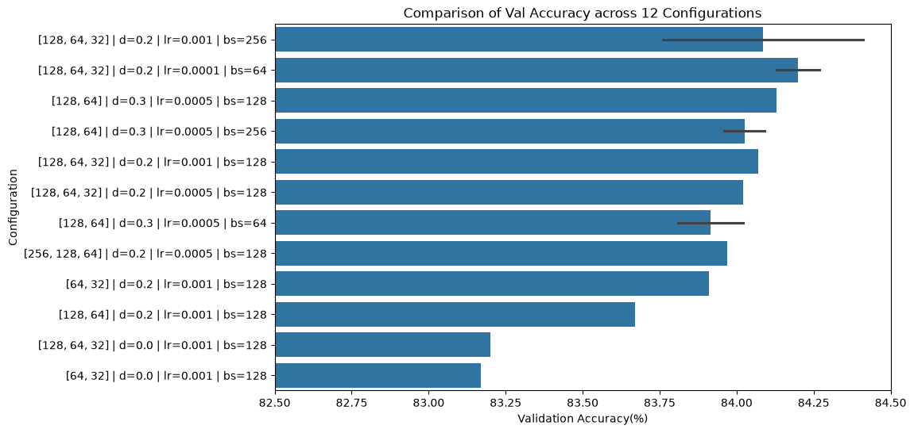
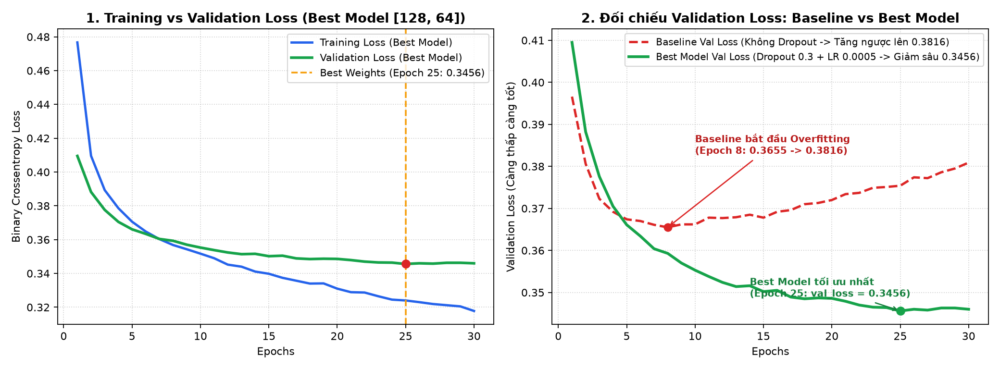

# 🏨 Hotel Booking Cancellation Prediction — Tabular ML vs. Deep Neural Networks (MLP)

[](https://www.python.org/)
[](https://scikit-learn.org/)
[](https://www.tensorflow.org/)
[](#1-dataset--domain-anomaly-detection)

> **Executive Summary:** Comprehensive machine learning & deep learning study on `119,390` hotel booking records (`hotel_bookings_raw.csv`) to predict reservation cancellations (`is_canceled`) and mitigate revenue loss. Includes rigorous data-leakage removal (`reservation_status`), domain anomaly detection (zero-guest, zero-night, and room-mismatch traps), and a multi-stage benchmark comparing **Logistic Regression**, **Random Forest**, and **12 Multi-Layer Perceptron (MLP)** configurations.

---

## 📂 Project Structure

```text
01-hotel-booking-cancellation-ml/
├── hotel_booking_cancellation_ml_dl.ipynb  # End-to-end EDA, preprocessing, ML & MLP tuning
├── README.md                               # Methodology, domain traps & benchmark summary
└── assets/                                 # Exported EDA & model evaluation plots
```

---

## 🔍 1. Dataset & Domain Anomaly Detection

The raw dataset consists of **`119,390` rows $\times$ `32` features** covering Resort Hotels and City Hotels (`37.04%` overall cancellation rate).



### Key Data Traps & Domain Anomalies Identified
1. **Target Leakage Prevention:**
   * `reservation_status` (`Canceled`, `Check-Out`, `No-Show`) and `reservation_status_date` directly encode the post-event outcome. Keeping them inflates accuracy to a fake `100%` while failing completely in production. Both columns are strictly dropped prior to splitting.
2. **Zero-Occupant Bookings (`180` rows):**
   * Records where `adults + children + babies == 0` are invalid ghost entries and removed (`119,390` $\rightarrow$ `119,210` rows).
3. **Zero-Night Stays (`total_nights == 0`, `715` rows) & Negative `adr`:**
   * `stays_in_weekend_nights + stays_in_week_nights == 0` represents same-day check-in/check-out or complimentary accounting adjustments.
4. **Room Type Mismatch (`assigned_room_type != reserved_room_type`, `14,917` rows):**
   * Operational upgrades or overbooking reassignments strongly correlate with lower cancellation rates (`~5.4%` vs `~41.5%`), making `is_room_mismatch` a high-signal engineered feature.

---

## 📊 2. Exploratory Data Analysis (EDA)

* **Lead Time vs. Cancellation:** Bookings made far in advance (`lead_time > 100` days) exhibit significantly higher cancellation risk.
* **Hotel Type & Deposit Policy:** City Hotels experience higher cancellation volume than Resort Hotels; `Non Refund` deposit tags in historical data show counter-intuitive cancellation spikes due to OTA group block practices.

| Hotel Type Breakdown | Lead Time Distribution | Correlation Heatmap |
| :---: | :---: | :---: |
|  |  |  |

---

## ⚙️ 3. Classical Machine Learning vs. Deep Learning (MLP) Benchmark

### Classical Baselines
* **Logistic Regression:** Fast linear baseline (`Accuracy: 80.93%`, `ROC-AUC: 0.8927`).
* **Random Forest Classifier (`200` trees, `max_depth=20`):** Captures non-linear feature interactions (`Accuracy: 86.25%`, `F1-Score: 0.8009`, `ROC-AUC: 0.9333`).

| Confusion Matrix Comparison | Top 15 Feature Importances (Random Forest) |
| :---: | :---: |
|  |  |

### Two-Stage Deep Neural Network (MLP) Hyperparameter Tuning
We conducted a systematic 2-stage search across **12 MLP architectures**:
* **Stage 1 (Optimizer & Learning Rate):** Evaluated `Adam` vs `SGD` across `lr` $\in \{0.01, 0.001, 0.0005\}$ with `EarlyStopping` (`patience=4`). `Adam (lr=0.001)` achieved the most stable validation convergence.
* **Stage 2 (Network Depth & Batch Size):** Tested 3 funnel architectures (`[64, 32]`, `[128, 64]`, `[128, 64, 32]`) across `batch_size` $\in \{128, 256\}$.

| Learning Curves across 6 Optimizers/LRs | Final Model Comparison (LogReg vs RF vs Best MLP) |
| :---: | :---: |
|  |  |

---

## 🏆 4. Final Benchmark & Business Recommendations

| Model | Test Accuracy | Precision | Recall | F1-Score | ROC-AUC |
| :--- | :---: | :---: | :---: | :---: | :---: |
| **Logistic Regression** | `80.93%` | `0.8027` | `0.6427` | `0.7139` | `0.8927` |
| **Deep Neural Network (Best MLP)** | `84.41%` | `0.8226` | `0.7392` | `0.7787` | `0.9225` |
| **Random Forest (Winner for Tabular)** | **`86.25%`** | **`0.8588`** | **`0.7503`** | **`0.8009`** | **`0.9333`** |

### Key Takeaway
Consistent with modern ML literature on structured tabular data, **tree-based ensemble models (`Random Forest`) outperform Deep Neural Networks (`MLP`)** both in predictive accuracy (`86.25%` vs `84.41%`) and interpretability, while MLP shines when combined with unstructured embeddings.
