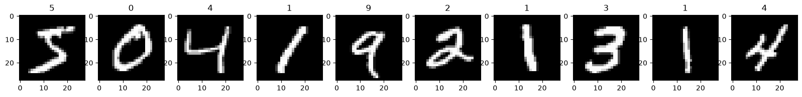
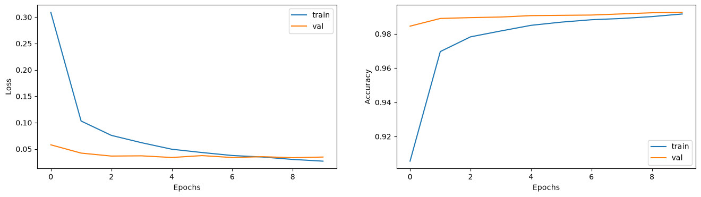
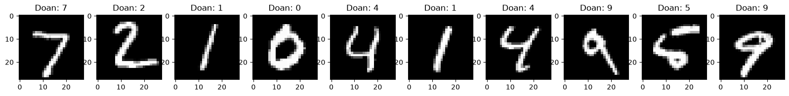
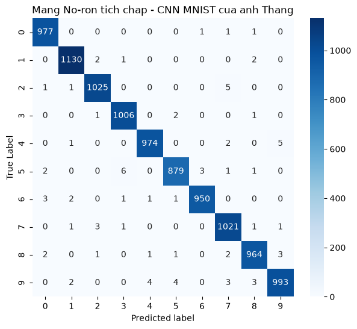
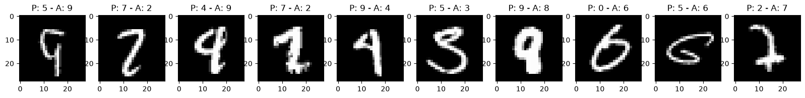
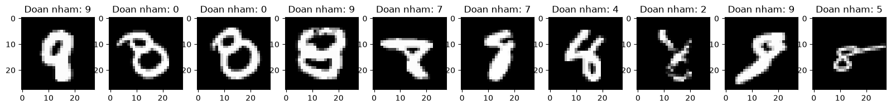

# 👁️ Handwritten Digit Recognition & Error Analysis with CNN (MNIST)

[](https://www.python.org/)
[](https://www.tensorflow.org/)
[](https://scikit-learn.org/)
[](#results--evaluation)

> **Executive Summary:** End-to-end Convolutional Neural Network (CNN) pipeline built with TensorFlow/Keras to classify $28 \times 28$ grayscale handwritten digits (`MNIST`). Achieved **99.19% accuracy** (`9,919 / 10,000` correct predictions) on unseen test data in 10 epochs, complete with idempotent preprocessing guardrails, confusion matrix diagnostics, and visual error analysis on ambiguous handwriting samples.

---

## 📂 Project Structure

```text
02-cnn-mnist-digit-recognition/
├── cnn_mnist_digit_recognition.ipynb   # Full executed Jupyter Notebook (Chặng 1 -> Chặng 5)
├── README.md                           # Architecture, mathematical breakdown & error analysis
└── assets/                             # Exported plots & evaluation visualizations
    ├── 01_mnist_samples.png
    ├── 02_training_loss_accuracy.png
    ├── 03_test_predictions_sample.png
    ├── 04_misclassified_samples.png
    ├── 05_confusion_matrix.png
    └── 06_misclassified_digit_9.png
```

---

## 🧠 1. Dataset & Idempotent Preprocessing

* **Training Set:** `60,000` grayscale images ($28 \times 28$ pixels)
* **Test Set:** `10,000` unseen grayscale images ($28 \times 28$ pixels)
* **Classes:** 10 discrete digits (`0` through `9`)



### Engineering Guardrails (Preventing Notebook Re-run Bugs)
A common pitfall in interactive notebooks is running normalization (`X / 255.0`) or dimension expansion (`np.expand_dims`) multiple times, which either crushes pixel intensities to zero or inflates tensors to 5D `(60000, 28, 28, 1, 1)`. Our pipeline enforces idempotent checks:
1. **Pixel Normalization:** Scale `[0, 255]` $\rightarrow$ `[0.0, 1.0]` only if `X_train.max() > 1.0`.
2. **Channel Expansion:** Reshape `(N, 28, 28)` $\rightarrow$ `(N, 28, 28, 1)` only if `X_train.ndim == 3`.
3. **One-Hot Encoding:** Convert integer labels to 10-dimensional probability vectors `(60000, 10)` via `to_categorical`.

---

## 🏗️ 2. CNN Architecture & Parameter Math

Unlike traditional Dense Neural Networks (DNN) which flatten spatial structure immediately, this architecture uses two hierarchical **Feature Extraction** blocks (`Conv2D` + `MaxPooling2D`) before classification:

| Layer (Type) | Output Shape | Filter / Pool Size | Activation | Parameters | Mathematical Breakdown |
| :--- | :--- | :--- | :--- | ---: | :--- |
| **`Conv2D` (#1)** | `(None, 28, 28, 32)` | 32 filters ($3 \times 3$), `same` | `ReLU` | `320` | $(3 \times 3 \times 1 + 1_{\text{bias}}) \times 32 = 320$ |
| **`MaxPooling2D` (#1)** | `(None, 14, 14, 32)` | Pool $2 \times 2$, stride 2 | — | `0` | Downsamples $28 \times 28 \rightarrow 14 \times 14$ |
| **`Conv2D` (#2)** | `(None, 14, 14, 64)` | 64 filters ($3 \times 3$), `same` | `ReLU` | `18,496` | $(3 \times 3 \times 32 + 1_{\text{bias}}) \times 64 = 18,496$ |
| **`MaxPooling2D` (#2)** | `(None, 7, 7, 64)` | Pool $2 \times 2$, stride 2 | — | `0` | Downsamples $14 \times 14 \rightarrow 7 \times 7$ |
| **`Flatten`** | `(None, 3136)` | — | — | `0` | $7 \times 7 \times 64 = 3,136$ features |
| **`Dense` (Hidden)** | `(None, 128)` | 128 units | `ReLU` | `401,536` | $(3,136 + 1_{\text{bias}}) \times 128 = 401,536$ |
| **`Dropout`** | `(None, 128)` | `rate = 0.5` | — | `0` | Randomly disables 50% neurons during training |
| **`Dense` (Output)** | `(None, 10)` | 10 units | `Softmax` | `1,290` | $(128 + 1_{\text{bias}}) \times 10 = 1,290$ |

* **Total Trainable Parameters:** **`421,642`** (~1.61 MB)
* **Optimizer:** `Adam` | **Loss:** `CategoricalCrossentropy` | **Batch Size:** `256` | **Validation Split:** `20%`

---

## 📈 3. Training Dynamics & Convergence

The model was trained for **10 epochs** (`48,000` training samples, `12,000` validation samples):
* **Epoch 1:** `loss: 0.4562` — `accuracy: 0.8602` — `val_loss: 0.1095` — `val_accuracy: 0.9682`
* **Epoch 10:** `loss: 0.0273` — `accuracy: 0.9916` — `val_loss: 0.0348` — `val_accuracy: 0.9925`



> **Observation:** Validation loss (`val_loss`) decreases smoothly alongside training loss without diverging upward, confirming that the `MaxPooling2D` spatial compression and `Dropout(0.5)` layer effectively prevent overfitting.

---

## 🎯 4. Results & Error Analysis on 10,000 Test Images

* **Test Accuracy:** **`99.19%`** (`9,919` correct / `81` misclassified out of `10,000` samples)
* **Macro F1-Score:** **`0.99`** across all 10 digit classes

### First 10 Unseen Test Predictions (`10/10` Correct)


### Confusion Matrix (`10,000` Test Samples)


### Deep-Dive Error Analysis: Why Did the Model Miss 81 Images?
Inspecting the `81` misclassified images (`P` = Predicted, `A` = Actual Ground Truth) reveals human-level ambiguity in raw handwriting:


#### Case Study: Misclassified Digit `9`s (`16 / 1,009` cases)
Out of `1,009` actual digit `9`s in the test set, the model correctly identified `993` (`Recall = 98.4%`) and misclassified only `16` samples:

* **Open Top Loop (`9` $\rightarrow$ `4` or `7`):** When the writer fails to close the upper loop of `9`, the vertical stem and horizontal crossbar strongly activate `4` and `7` edge filters.
* **Tilted / Slashed Stroke (`9` $\rightarrow$ `8` or `5`):** Overlapping loops or heavy bottom curves mimic the lower belly of `8` or `5`.
