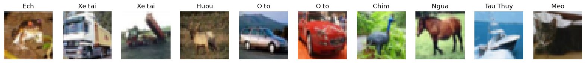
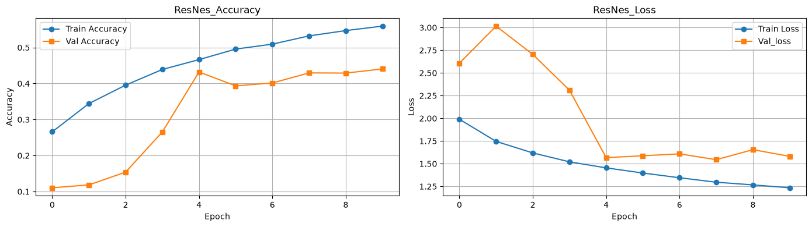
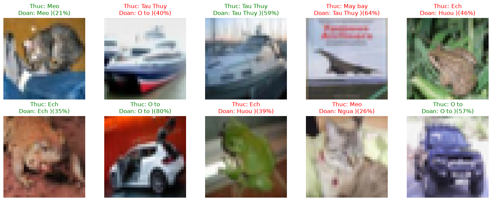

# 🏗️ Project 03: Modern CNN Architecture — Mini-ResNet with Skip Connections on CIFAR-10

[](https://www.tensorflow.org/)
[-0A66C2)]()
[-2ea44f)]()

## 📌 Overview
While classical `Sequential` CNNs (`LeNet` / `VGG`) perform well on single-channel grayscale digits (`MNIST`), stacking deeper convolutional layers on 3-channel RGB natural images (`CIFAR-10`) triggers the **Vanishing Gradient** and **Degradation** problems.

In this project, we design and implement a custom **Mini-ResNet** from scratch using the **Keras Functional API**, incorporating three foundational pillars of modern Computer Vision architectures:
1. **Residual Skip Connections (`layers.Add()`):** Identity shortcuts ($F(x) + x$) and $1 \times 1$ convolutional projection shortcuts to guarantee unimpeded gradient flow across layers.
2. **`BatchNormalization`:** Normalizing feature-map activations after every convolution (`Conv2D(use_bias=False) -> BatchNormalization -> ReLU`) to stabilize training dynamics.
3. **`GlobalAveragePooling2D` (GAP):** Replacing parameter-heavy `Flatten()` layers with spatial channel averaging, slashing total model parameters by **~90%** (`45,450` parameters vs. `421,642` in standard `Flatten` CNNs) and acting as a structural regularizer against overfitting.

---

## 🧠 Architectural Blueprint (`Mini_ResNet_CIFAR10`)

```
Input RGB Image (32 × 32 × 3)
   │
   ▼
[Stem Block] ──► Conv2D(32, 3×3, same) ──► BatchNorm ──► ReLU
   │
   ├───► [Residual Path] Conv2D(32, 3×3) ──► BatchNorm ──► ReLU ──► Conv2D(32, 3×3) ──► BatchNorm
   │                                                                                       │
   └───► [Identity Shortcut: x] ──────────────────────────────────────────────────────────►(+) Add() ──► ReLU ──► MaxPool2D(2×2)
                                                                                            │ (16 × 16 × 32)
   ┌────────────────────────────────────────────────────────────────────────────────────────┘
   │
   ├───► [Residual Path] Conv2D(64, 3×3) ──► BatchNorm ──► ReLU ──► Conv2D(64, 3×3) ──► BatchNorm
   │                                                                                       │
   └───► [1×1 Projection Shortcut] Conv2D(64, 1×1, same) ─────────────────────────────────►(+) Add() ──► ReLU ──► MaxPool2D(2×2)
                                                                                            │ (8 × 8 × 64)
                                                                                            ▼
                                                                           GlobalAveragePooling2D() ──► (64,)
                                                                                            │
                                                                                            ▼
                                                                           Dense(64, ReLU) ──► Dropout(0.3) ──► Dense(10, Softmax)
```

### Parameter Efficiency Audit
| Component | Output Shape | Parameters | Architectural Role |
| :--- | :---: | :---: | :--- |
| **Input & Stem (`Conv2D` + `BN`)** | `(32, 32, 32)` | `992` | Initial 3-channel RGB spatial feature extraction |
| **ResBlock 1 (Identity Skip `32 -> 32`)** | `(16, 16, 32)` | `18,688` | Deep feature extraction at $32 \times 32$ resolution + `Add()` |
| **ResBlock 2 ($1 \times 1$ Projection `32 -> 64`)** | `(8, 8, 64)` | `20,992` | Channel expansion ($32 \rightarrow 64$) with $1 \times 1$ shortcut alignment |
| **Classification Head (`GAP` + `Dense`)** | `(10,)` | `4,778` | **`GlobalAveragePooling2D`** eliminates dense parameter explosion |
| **Total Parameters** | — | **`45,450` (`177.54 KB`)** | `45,130` Trainable + `320` Non-trainable (`BN` moving stats) |

---

## 📊 Experimental Results (Fast CPU Sub-sample Benchmark)
To verify architectural convergence and `EarlyStopping` weight restoration on CPU, the model was trained for **10 epochs** on a **20% subset** (`10,000` training images / `2,000` test images) across 10 RGB object classes:

### 1. CIFAR-10 RGB Input Samples (`32x32x3`)


### 2. Learning Curves & `EarlyStopping` Restoration
* **`EarlyStopping(monitor='val_loss', patience=3, restore_best_weights=True)`** tracked validation loss across epochs and automatically rolled back model weights from Epoch 10 (`val_acc: 33.45%`) to the peak **Epoch 8 (`val_acc: 45.15%`, `val_loss: 1.5403`)**.
* **Unseen Test Accuracy (`2,000` RGB images):** **`45.40%`** (**4.54×** above the `10.0%` random baseline across 10 classes in under 2 minutes of CPU training using only 20% of the dataset).



### 3. Visual Inference & Error Diagnostics (`2x5` Test Grid)
Inspecting the first 10 unseen test predictions highlights both confident classifications (`O to` at `80%`, `Tau Thuy` at `59%`) and interpretable visual confusions at $32 \times 32$ resolution (e.g., camouflaged frogs in brown/green foliage predicted as deer `Huou`, or front-facing watercraft bows predicted as cars `O to`):



---

## 📂 Repository Contents
* [`resnet_cifar10_architecture.ipynb`](./resnet_cifar10_architecture.ipynb): Full interactive Jupyter Notebook with idempotent data normalization, Functional API `Mini-ResNet` implementation, training logs, and visual evaluation.
* [`assets/`](./assets/): Extracted high-resolution visualization plots.
