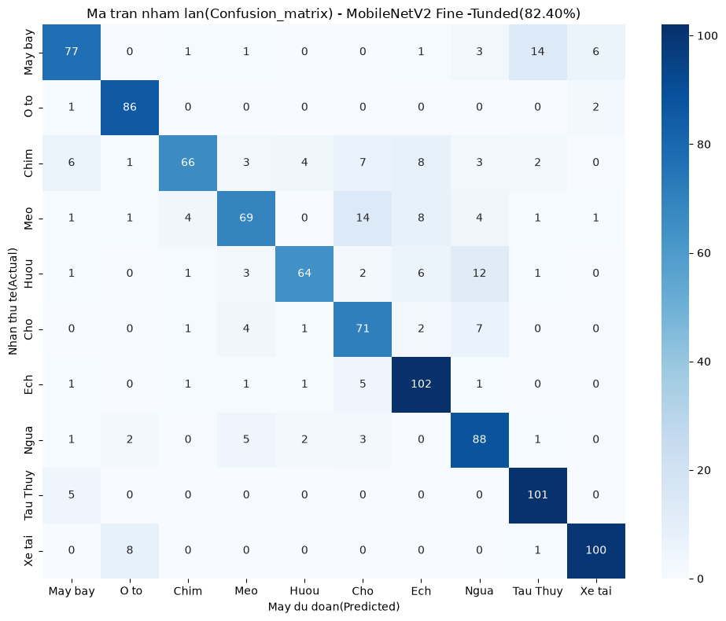
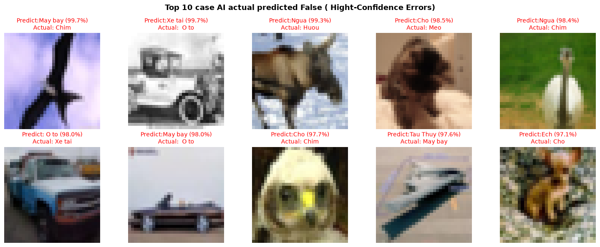
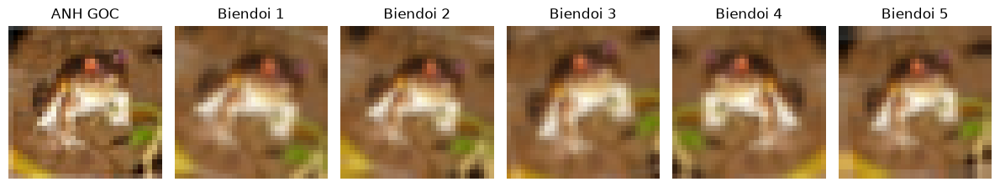
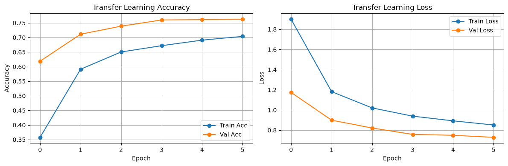
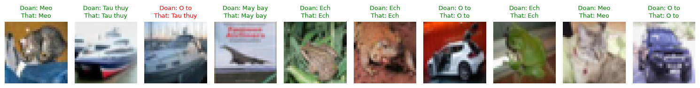

# 🔄 Transfer Learning, Fine-Tuning & Deep Error Analysis with MobileNetV2 on CIFAR-10

[](https://www.tensorflow.org/)
[-0A66C2)](./cv_error_analysis_and_finetuning.ipynb)
[-2ea44f)](./cv_error_analysis_and_finetuning.ipynb)
[](./cv_error_analysis_and_finetuning.ipynb)

## 📌 Executive Summary
Training deep Convolutional Neural Networks from scratch on small datasets often leads to severe overfitting or slow convergence. Across a 3-stage experimental progression on `CIFAR-10`:
1. **Stage 1 — Scratch `Mini-ResNet` ([Project 03](../03-modern-cnn-resnet-cifar10/)):** Training from random initialization achieved **`45.40%` test accuracy**.
2. **Stage 2 — Frozen `MobileNetV2` Feature Extraction ([`transfer_learning_mobilenetv2_cifar10.ipynb`](./transfer_learning_mobilenetv2_cifar10.ipynb)):** Freezing 100% of the ImageNet-pretrained `MobileNetV2` backbone and training only a `12,810`-parameter classification head with in-graph Data Augmentation boosted unseen test accuracy to **`76.50%` (+31.10%)** in 22 seconds on CPU.
3. **Stage 3 — `MobileNetV2` Fine-Tuning & Error Auditing ([`cv_error_analysis_and_finetuning.ipynb`](./cv_error_analysis_and_finetuning.ipynb)):** Unfreezing the **top 20 convolutional layers** of `MobileNetV2` with a conservative learning rate (`Adam(learning_rate=1e-4)`) pushed validation accuracy to **`84.50%`** and unseen test accuracy to **`82.40%` (+37.00% over scratch CNN)**, followed by a rigorous per-class **Precision/Recall/F1-Score audit**, **Confusion Matrix heatmap**, and **Top 10 High-Confidence Error inspection**.

---

## 📊 Stage-by-Stage Benchmark Comparison

| Metric | Stage 1: Scratch `Mini-ResNet` | Stage 2: Frozen `MobileNetV2` | Stage 3: Fine-Tuned `MobileNetV2` (Top 20 Layers) | Engineering Impact |
| :--- | :---: | :---: | :---: | :--- |
| **Training Dataset Size** | `8,000` images | `4,000` images | **`4,000` images** | **50% less training data required** |
| **Trainable Parameters** | `45,130` | `12,810` | **`1,218,890`** | Unfroze top 20 high-level semantic layers |
| **Optimizer & Learning Rate** | `Adam(1e-3)` | `Adam(1e-3)` | **`Adam(1e-4)`** | 10x smaller step prevents catastrophic forgetting |
| **Peak Validation Accuracy** | `47.50%` | `76.25%` | **`84.50%`** | Smooth convergence with `EarlyStopping` |
| **Unseen Test Accuracy (`1,000` imgs)** | `45.40%` | `76.50%` | **`82.40%`** | **🚀 `+37.00%` total accuracy gain** |

---

## 🔬 Deep Error Analysis & Model Diagnostics (Stage 3)

### 1. Per-Class Precision, Recall & F1-Score Audit (`classification_report`)
| Class | Precision | Recall | F1-Score | Support | Diagnostic Insight |
| :--- | :---: | :---: | :---: | :---: | :--- |
| **Automobile (`O to`)** | `0.8776` | **`0.9663`** | **`0.9198`** | `89` | Highest recall (`96.63%`); distinct wheel/chassis geometry |
| **Truck (`Xe tai`)** | **`0.9174`** | `0.9174` | **`0.9174`** | `109` | Highest precision (`91.74%`); minimal false positives |
| **Ship (`Tau Thuy`)** | `0.8347` | `0.9528` | `0.8899` | `106` | Strong maritime background recognition |
| **Frog (`Ech`)** | `0.8031` | `0.9107` | `0.8536` | `112` | High recall; occasional confusion with crouched cats |
| **Horse (`Ngua`)** | `0.7458` | `0.8627` | `0.8000` | `102` | Absorbs false positives from hornless deer |
| **Deer (`Huou`)** | `0.8889` | `0.7111` | `0.7901` | `90` | High precision when antlers are visible; `12` misclassified as horses |
| **Airplane (`May bay`)** | `0.8280` | `0.7476` | `0.7857` | `103` | `14` seaplanes/sky-background planes confused with ships |
| **Bird (`Chim`)** | `0.8919` | `0.6600` | `0.7586` | `100` | Gliding silhouettes against blue sky confused with airplanes |
| **Dog (`Cho`)** | `0.6961` | `0.8256` | `0.7553` | `86` | Lowest precision (`69.61%`) due to `14` cats misclassified as dogs |
| **Cat (`Meo`)** | `0.8023` | `0.6699` | `0.7302` | `103` | Hardest class at `32x32` resolution (`14` confused with dogs, `8` with frogs) |

### 2. Confusion Matrix Heatmap (`10 x 10` Cross-Class Audit)
The confusion matrix reveals the exact semantic clusters where visual ambiguity occurs at `32x32` resolution:
* **`Cat` $\rightarrow$ `Dog` (`14` cases):** Fur texture and crouched indoor poses without visible pointed ears trigger dog predictions.
* **`Airplane` $\rightarrow$ `Ship` (`14` cases):** Blue sky vs. blue ocean backgrounds and elongated white fuselages/hulls.
* **`Deer` $\rightarrow$ `Horse` (`12` cases):** Side-profile quadrupeds on grass where antlers are cropped or indistinct.



### 3. Top 10 High-Confidence Errors (`97.1% - 99.7%` Confidence)
Inspecting the top 10 errors sorted by predicted probability (`np.max(y_pred_probs, axis=1)`) demonstrates that the model's highest-confidence mistakes occur on visually ambiguous edge cases (e.g., a black bird gliding with straight wings predicted as `Airplane (99.7%)`, a vintage boxy car predicted as `Truck (99.7%)`, and a seaplane on water predicted as `Ship (97.6%)`):



---

## 📈 Stage 2 Visuals: Frozen Feature Extraction (`76.50%`)

| Real-Time Data Augmentation | Stage 2 Learning Curves & Sample Strip (`9/10` Correct) |
| :---: | :---: |
|  | <br> |

---

## 📂 Repository Structure
```text
04-transfer-learning-mobilenetv2-cifar10/
├── cv_error_analysis_and_finetuning.ipynb       # Stage 3: Fine-Tuning (82.40%) + Confusion Matrix + Error Audit
├── transfer_learning_mobilenetv2_cifar10.ipynb  # Stage 2: Frozen MobileNetV2 Feature Extraction (76.50%)
├── README.md                                    # Engineering documentation & 3-stage benchmark analysis
└── assets/
    ├── finetuned_confusion_matrix.png           # 10x10 Confusion Matrix Heatmap (82.40% Test Acc)
    ├── finetuned_top10_errors.png               # Top 10 High-Confidence Errors (97.1% - 99.7%)
    ├── data_augmentation_preview.png            # 1 original vs. 5 augmented training samples
    ├── mobilenetv2_learning_curves.png          # Stage 2 Accuracy & Loss curves
    └── mobilenetv2_test_predictions.png         # 10 unseen test predictions (9/10 correct)
```
