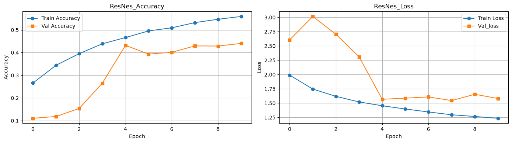
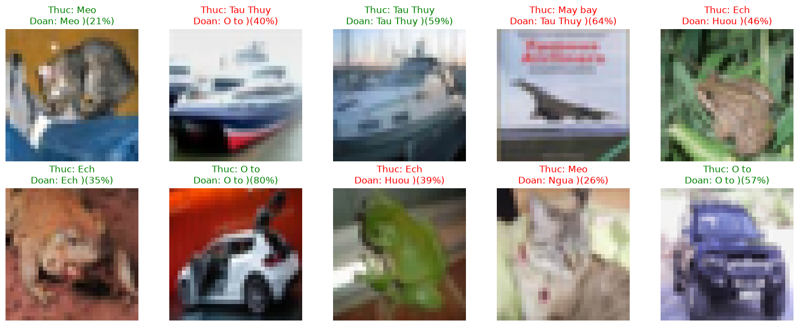
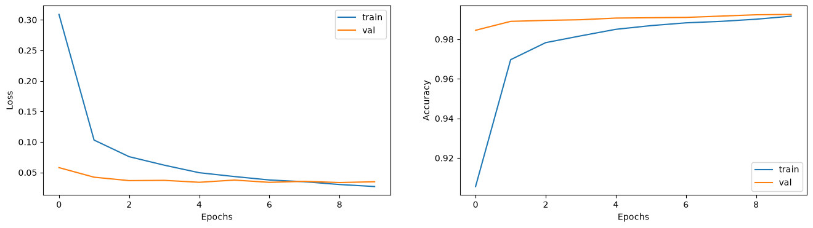
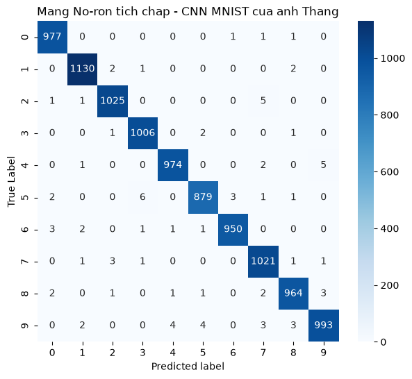
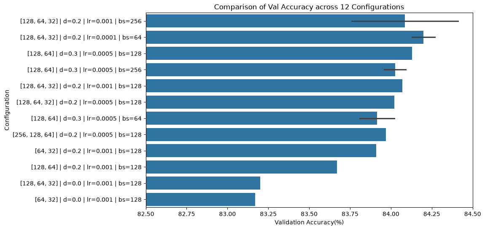
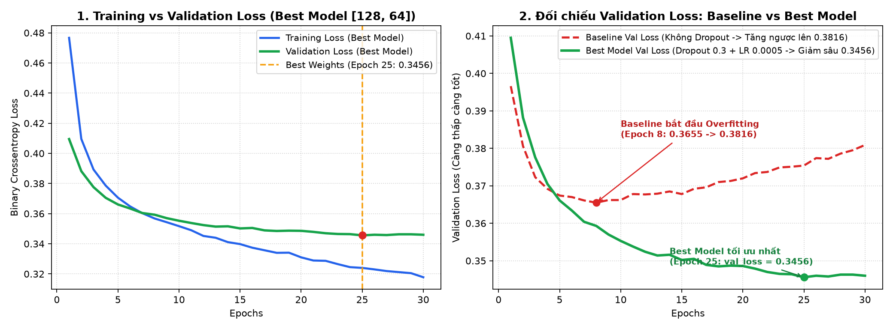

# 🚀 Applied AI & Deep Learning Engineering Portfolio

Welcome to my **Applied AI & Deep Learning Engineering Portfolio**. This repository showcases production-oriented Machine Learning, Computer Vision, Natural Language Processing (NLP), Retrieval-Augmented Generation (RAG), and Multi-Agent Automation projects with a strong focus on **real-world business impact, data integrity, and end-to-end deployment**.

---

## 🗂️ Featured Projects & Modules

| # | Project / Module | Domain | Key Tech Stack | Highlight Metric / Outcome | Status |
| :-: | :--- | :--- | :--- | :--- | :-: |
| **01** | [**Hotel Booking Cancellation Prediction**](./01-hotel-booking-cancellation-ml/) | Tabular ML & Deep Neural Networks (MLP) | `Python`, `Pandas`, `Scikit-Learn`, `TensorFlow/Keras` | **`86.25%` Accuracy (`0.9333` ROC-AUC)** across `119,210` bookings; full data-leakage & anomaly audit | ✅ Completed |
| **02** | [**CNN Handwritten Digit Recognition & Error Analysis**](./02-cnn-mnist-digit-recognition/) | Computer Vision (CNN) | `TensorFlow/Keras`, `Conv2D`, `MaxPooling2D`, `Seaborn` | **`99.19%` Test Accuracy** (`9,919/10,000` unseen samples); idempotent pipeline & error diagnostics | ✅ Completed |
| **03** | [**Modern CNN: Mini-ResNet with Skip Connections (`CIFAR-10`)**](./03-modern-cnn-resnet-cifar10/) | Deep CV Architectures | `Keras Functional API`, `Add (Skip Connection)`, `BatchNormalization`, `GlobalAveragePooling2D` | **`45,450` Lightweight Params** (`90%` reduction vs. `Flatten`); residual identity & $1\times 1$ projection blocks on RGB images | ✅ Completed |
| **04** | **Transfer Learning & Real-Time Object Detection (`MobileNet` / `YOLO`)** | Computer Vision & Edge AI | `Transfer Learning`, `Data Augmentation`, `YOLO` | Real-world image classification & object detection for mobile inspection | 🔄 In Progress |
| **05** | **Transformer Fine-Tuning & Semantic Search** | NLP | `HuggingFace`, `BERT`, `Embeddings` | Domain-specific text classification, NER & semantic retrieval | 📅 Upcoming |
| **06** | **Enterprise RAG Chatbot & Document Intelligence** | GenAI / LLMs | `LangChain`, `Vector DB`, `OpenAI / Gemini` | Grounded Q&A over enterprise PDFs with hallucination guardrails | 📅 Upcoming |
| **07** | **Autonomous Multi-Agent B2B Workflow Engine** | Agentic AI | `Multi-Agent`, `MCP`, `FastAPI`, `Playwright` | Automated B2B lead intelligence, document extraction & quotation generation | 📅 Upcoming |

---

## 🔬 Visual Highlights

### 1. Modern CNN: Mini-ResNet with Residual Skip Connections ([`03-modern-cnn-resnet-cifar10`](./03-modern-cnn-resnet-cifar10/))
* Designed a custom **Mini-ResNet** using the Keras Functional API (`Conv2D` + `BatchNormalization` + `Add()` Identity & $1\times 1$ Projection Skip Connections + `GlobalAveragePooling2D`), reducing parameter count to just **`45,450` (`177.54 KB`)** on 3-channel RGB `CIFAR-10` images.

| Mini-ResNet Learning Curves (`EarlyStopping`) | Unseen RGB Test Predictions (`2x5` Grid) |
| :---: | :---: |
|  |  |

---

### 2. Computer Vision: CNN Feature Extraction & Error Diagnostics ([`02-cnn-mnist-digit-recognition`](./02-cnn-mnist-digit-recognition/))
* Built a 421K-parameter Convolutional Neural Network (`Conv2D` $\rightarrow$ `MaxPooling2D` $\rightarrow$ `Dropout(0.5)` $\rightarrow$ `Softmax`) achieving **99.19% test accuracy** in 10 epochs.

| Training & Validation Curves | Confusion Matrix (`10,000` Unseen Test Images) |
| :---: | :---: |
|  |  |

---

### 3. Tabular ML vs. Deep Learning Benchmark ([`01-hotel-booking-cancellation-ml`](./01-hotel-booking-cancellation-ml/))
* Benchmarked **Logistic Regression**, **Random Forest**, and **12 Multi-Layer Perceptron (MLP)** architectures across `119,210` cleaned hotel reservations after eliminating target leakage (`reservation_status`) and domain anomalies (`total_nights == 0`, room type mismatches).

| MLP Optimizer & Learning Rate Search | Final Benchmark (LogReg vs. Random Forest vs. Best MLP) |
| :---: | :---: |
|  |  |

---

## 🛠️ Core Engineering Principles
1. **Idempotent & Reproducible Pipelines:** Every preprocessing step includes explicit shape and range assertions so cells and scripts can be re-executed safely without state corruption.
2. **Data-First Auditing:** Uncovering domain traps, target leakage, and edge-case anomalies before training complex architectures.
3. **Business-Driven Metrics:** Optimizing for precision, recall, F1-score, ROC-AUC, and inference latency rather than vanity training accuracy.

---

## 📫 Contact & Collaboration
* **Author:** Bùi Văn Thắng (`vanthangqtbv-cpu`)
* **Email:** [vanthangqtbv@gmail.com](mailto:vanthangqtbv@gmail.com)
* **Focus Areas:** Applied AI Engineering, Computer Vision, Enterprise RAG & Multi-Agent Automation, Cross-Platform Mobile (Flutter)
